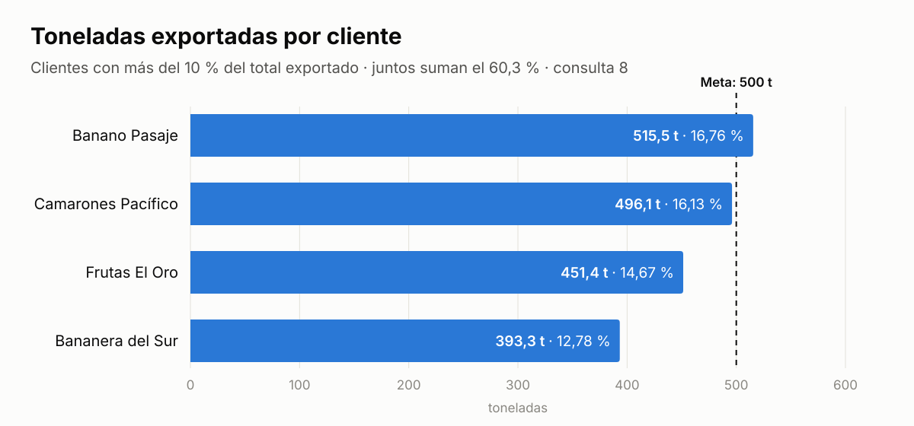
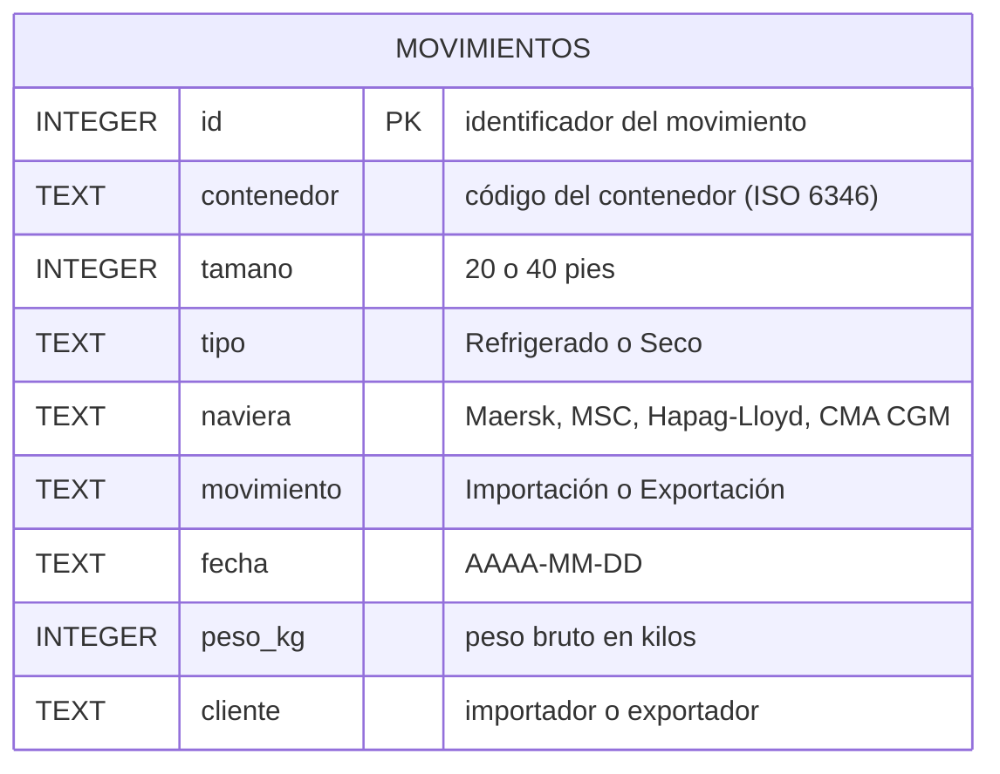

# 🚢 Análisis de movimientos de contenedores con SQL

Preguntas de negocio de una terminal portuaria respondidas con SQL (SQLite), sobre una base de **200 movimientos de contenedores** de septiembre de 2026: importaciones y exportaciones de cuatro navieras y quince clientes.

> Proyecto de práctica con **datos simulados**: clientes y contenedores inventados, navieras reales. No contiene información de ninguna empresa.

## Hallazgos principales

- **Cuatro clientes concentran el 60,3 % de los kilos exportados**: Banano Pasaje, Camarones Pacífico, Frutas El Oro y Bananera del Sur. Una cartera tan concentrada hace que la pérdida de uno solo se note en el volumen de la terminal. *(consulta 8)*
- **Banano Pasaje ya superó las 500 toneladas exportadas (515,5 t) y a Camarones Pacífico le faltan 3,9 t** para llegar a esa meta. *(consulta 8)*
- **Las importaciones están repartidas entre las cuatro navieras**: MSC lidera con el 29,6 % de los contenedores y la que menos mueve, CMA CGM, llega al 19,7 %. *(consulta 4)*
- **Agroinsumos El Oro es el mayor importador** (20 contenedores) y también el de pesos más dispares: **13,6 t** de diferencia entre su contenedor más pesado y el más liviano. *(consultas 1 y 9)*



## La base de datos

Una tabla, `movimientos`: cada fila es un contenedor que entró (importación) o salió (exportación) de la terminal.



## Consultas

Las 9 consultas están en [`consultas.sql`](consultas.sql), cada una con su pregunta de negocio encima y el resultado esperado debajo.

| # | Pregunta de negocio | Nivel | Qué demuestra |
|---|---|---|---|
| 1 | Importaciones y peso promedio por cliente | Medio | `GROUP BY`, `COUNT`, `AVG`, `ROUND`, orden por alias |
| 2 | Parejas naviera–cliente con al menos 5 exportaciones | Medio | `GROUP BY` de dos columnas, `HAVING`, orden dentro de cada grupo |
| 3 | Clientes de carga seca con peso promedio > 21 t en un rango de fechas | Medio | `IN`, `BETWEEN`, `HAVING AVG` |
| 4 | Participación de cada naviera en las importaciones | Medio | Toneladas y porcentajes calculados (`/ 1000.0`, `* 100.0`) |
| 5 | Indicadores de un segmento con cinco condiciones | Alto | `AND` / `OR` con paréntesis, `NOT`, `COUNT(DISTINCT)`, `MAX` |
| 6 | El contenedor más pesado de ese segmento | Alto | Método de dos pasos: el filtro se repite y se añade el máximo |
| 7 | Grupos cliente–tamaño con dos umbrales | Alto | `HAVING` con dos condiciones, `WHERE` frente a `HAVING` |
| 8 | Concentración de exportaciones y brecha frente a una meta | Alto | Porcentaje dentro del `HAVING`, columna calculada de brecha |
| 9 | Dispersión de pesos por cliente importador | Alto | Resta de funciones con paréntesis `(MAX - MIN) / 1000.0` |

## Ejemplo: concentración de exportaciones

```sql
-- 8. Clientes con más del 10 % de los kilos exportados:
--    toneladas, porcentaje del total y cuánto les falta para 500 t.
SELECT cliente,
       ROUND(SUM(peso_kg) / 1000.0, 1)            AS toneladas,
       ROUND(SUM(peso_kg) * 100.0 / 3076500, 2)   AS porcentaje,
       ROUND(500 - SUM(peso_kg) / 1000.0, 1)      AS faltan_para_500
FROM movimientos
WHERE movimiento = 'Exportación'
GROUP BY cliente
HAVING SUM(peso_kg) * 100.0 / 3076500 > 10
ORDER BY porcentaje DESC;
```

| cliente | toneladas | porcentaje | faltan_para_500 |
|---|---:|---:|---:|
| Banano Pasaje | 515.5 | 16.76 | -15.5 |
| Camarones Pacífico | 496.1 | 16.13 | 3.9 |
| Frutas El Oro | 451.4 | 14.67 | 48.6 |
| Bananera del Sur | 393.3 | 12.78 | 106.7 |

Un valor negativo en `faltan_para_500` significa que el cliente ya superó la meta.

## Pruébalo tú mismo

1. Abre [sqliteonline.com](https://sqliteonline.com).
2. Pega el contenido de [`base_practica_200.sql`](base_practica_200.sql) en el editor y pulsa **Run**.
3. Comprueba con `SELECT COUNT(*) FROM movimientos;` (debe dar 200) y ejecuta cualquier consulta de `consultas.sql`.

## Próximos pasos

- Cruzar la tabla con `clientes` y `navieras` (`JOIN`).
- Calcular los totales dentro de la consulta (subconsultas) en vez de escribirlos a mano (3.076.500 kg y 71 importaciones).
- Clasificar movimientos con `CASE` y analizar por semana con funciones de fecha.

---
**Byron Bustamante** · Economista · Análisis de datos (Excel, Power BI, SQL) · [Tablero de Power BI](https://byronbustamanteg700.github.io/powerbi-control-comercial/)
