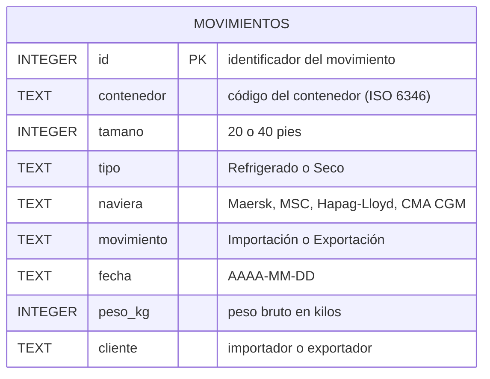

# 🚢 Análisis de movimientos de contenedores con SQL

Preguntas de negocio de una terminal portuaria respondidas con SQL (SQLite), sobre una base de **200 movimientos de contenedores** de septiembre de 2026.

> Proyecto de práctica con **datos simulados**: clientes y contenedores inventados, navieras reales. No contiene información de ninguna empresa.

## Hallazgos principales

<!-- Completar con las cifras que salgan de TUS consultas (no copiar de memoria) -->

- **[Naviera]** movió el **[X] %** de los kilos exportados; junto con [naviera 2], casi [X] %. *(consulta 10)*
- **[X] clientes** concentran el **[X] %** de los kilos exportados. *(consulta 12)*
- **[X] de cada [X] exportaciones** son contenedores refrigerados (fruta y camarón). *(consulta 5)*
- **[Cliente]** ya superó las 500 toneladas exportadas; a **[cliente]** le faltan [X] t. *(consulta 12)*

<!-- Aquí irá el gráfico:  -->

## La base de datos

Una tabla, `movimientos`: cada fila es un contenedor que entró (importación) o salió (exportación) de la terminal.



## Preguntas respondidas

Todas las consultas están en [`consultas.sql`](consultas.sql), ordenadas de menos a más complejas.

| Bloque | Preguntas | Qué demuestra |
|---|---|---|
| 1. Básicas | 1 a 3 | `SELECT`, `WHERE` con `AND`/`OR`, `ORDER BY`, `LIMIT`, `DISTINCT` |
| 2. Resúmenes | 4 a 7 | `GROUP BY` de una y dos columnas, `COUNT`, `SUM`, `AVG`, `ROUND` |
| 3. Filtros sobre grupos | 8 y 9 | `HAVING`, diferencia entre `WHERE` y `HAVING` |
| 4. Indicadores | 10 a 12 | Toneladas, porcentajes y rangos calculados en la consulta |

## Ejemplo

```sql
-- 10. ¿Qué porcentaje de los kilos exportados movió cada naviera?
-- (pegar aquí tu consulta 10 y debajo la tabla de resultados)
```

| naviera | toneladas | porcentaje |
|---|---|---|
| [ ] | [ ] | [ ] |

## Pruébalo tú mismo

1. Abre [sqliteonline.com](https://sqliteonline.com).
2. Pega el contenido de [`base_practica_200.sql`](base_practica_200.sql) en el editor y pulsa **Run**.
3. Comprueba con `SELECT COUNT(*) FROM movimientos;` (debe dar 200) y ejecuta cualquier consulta de `consultas.sql`.

## Próximos pasos

- Cruzar la tabla con `clientes` y `navieras` (`JOIN`).
- Calcular los totales dentro de la consulta (subconsultas) en vez de escribirlos a mano.
- Clasificar movimientos con `CASE` y analizar por semana (funciones de fecha).

---
**Byron Bustamante** · Economista · Análisis de datos (Excel, Power BI, SQL) · [Tablero de Power BI](https://byronbustamanteg700.github.io/powerbi-control-comercial/)
