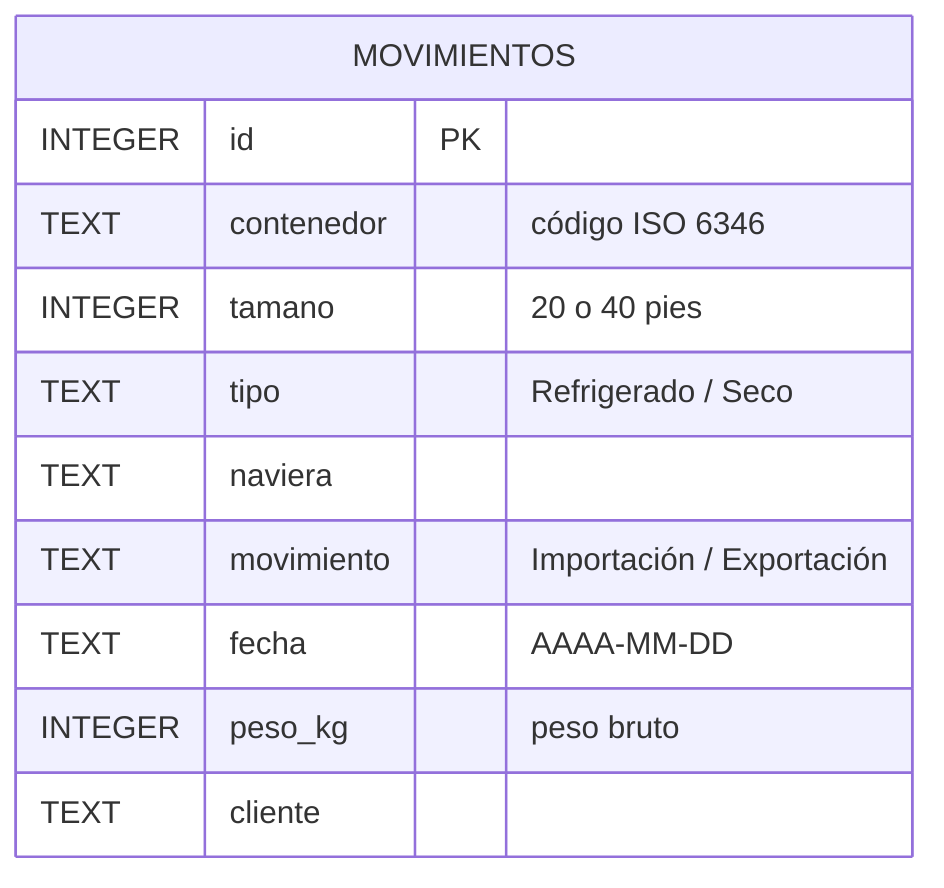

# Movimientos de contenedores: concentración de clientes y participación de navieras

Análisis en SQL (SQLite) de 200 movimientos de contenedores de una terminal portuaria durante septiembre de 2026: 129 exportaciones y 71 importaciones, cuatro navieras y quince clientes.

> Datos simulados: clientes y contenedores inventados, navieras reales.

## Hallazgos

- **Cuatro clientes concentran el 60,3 % de los kilos exportados** (Banano Pasaje, Camarones Pacífico, Frutas El Oro y Bananera del Sur). La pérdida de cualquiera de ellos movería el volumen de exportación de la terminal. → [`exportaciones.sql`](exportaciones.sql) E1
- **Banano Pasaje superó la meta de 500 t (+15,5 t); Camarones Pacífico quedó a 3,9 t** de alcanzarla. → [`exportaciones.sql`](exportaciones.sql) E1
- **Las importaciones están repartidas entre las cuatro navieras**: MSC lidera con el 29,6 % de los contenedores y CMA CGM, la de menor participación, tiene el 19,7 %. → [`navieras.sql`](navieras.sql) N1
- **Agroinsumos El Oro es el principal importador** (20 contenedores) y el de carga más dispar: 13,6 t entre su contenedor más pesado y el más liviano. → [`importaciones.sql`](importaciones.sql) I1 e I2


## Preguntas analizadas

| | Pregunta | Archivo |
|---|---|---|
| E1 | ¿Qué clientes concentran más del 10 % de lo exportado y cómo están frente a la meta de 500 t? | [`exportaciones.sql`](exportaciones.sql) |
| E2 | ¿Qué parejas naviera–cliente sostienen el volumen exportado? | [`exportaciones.sql`](exportaciones.sql) |
| E3 | Volumen y pesos de un segmento: 40 pies, MSC y Maersk, 5–25 de septiembre | [`exportaciones.sql`](exportaciones.sql) |
| E4 | ¿Cuál fue el contenedor más pesado de ese segmento? | [`exportaciones.sql`](exportaciones.sql) |
| I1 | ¿Quiénes son los importadores y cuánto pesa en promedio su carga? | [`importaciones.sql`](importaciones.sql) |
| I2 | ¿Qué importadores tienen cargas más dispares? | [`importaciones.sql`](importaciones.sql) |
| I3 | ¿Qué combinaciones cliente–tamaño superan 5 contenedores y 85 t (sin Maersk)? | [`importaciones.sql`](importaciones.sql) |
| N1 | ¿Qué participación tiene cada naviera en las importaciones? | [`navieras.sql`](navieras.sql) |
| N2 | ¿Qué clientes de carga seca de Maersk y CMA CGM promedian más de 21 t? | [`navieras.sql`](navieras.sql) |

## Datos

Tabla `movimientos` ([`movimientos.sql`](movimientos.sql)): una fila por contenedor que entró o salió de la terminal.



```bash
sqlite3 terminal.db < movimientos.sql
sqlite3 -header -column terminal.db < exportaciones.sql
```

---
**Byron Bustamante** · Economista · Análisis de datos (SQL, Power BI, Excel) · [LinkedIn](https://www.linkedin.com/in/byron-bustamante-ec/) · [Tablero de Power BI](https://byronbustamanteg700.github.io/powerbi-control-comercial/)
