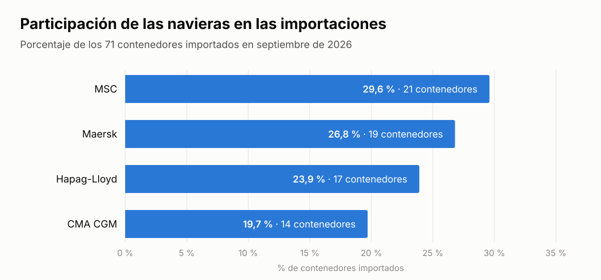
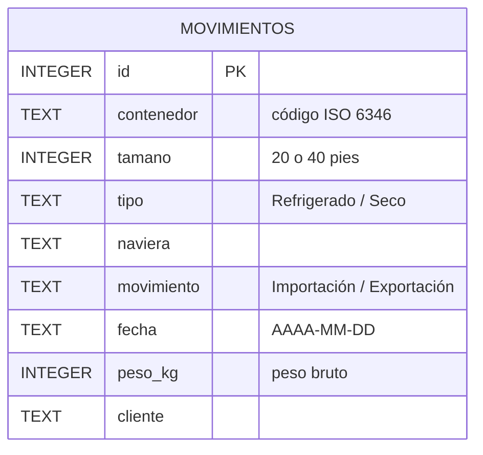

# Movimientos de contenedores: concentración de clientes y participación de navieras

Análisis en SQL (SQLite) de 200 movimientos de contenedores de una terminal portuaria durante septiembre de 2026: 129 exportaciones y 71 importaciones, cuatro navieras y quince clientes.

> Datos simulados: clientes y contenedores inventados, navieras reales.

## Hallazgos

- **Cuatro clientes concentran el 60,3 % de los kilos exportados** (Banano Pasaje, Camarones Pacífico, Frutas El Oro y Bananera del Sur). La pérdida de cualquiera de ellos movería el volumen de exportación de la terminal. → [`exportaciones.sql`](exportaciones.sql) E1
- **Banano Pasaje superó la meta de 500 t (+15,5 t); Camarones Pacífico quedó a 3,9 t** de alcanzarla. → [`exportaciones.sql`](exportaciones.sql) E1
- **Las importaciones están repartidas entre las cuatro navieras**: MSC lidera con el 29,6 % de los contenedores y CMA CGM, la de menor participación, tiene el 19,7 %. → [`navieras.sql`](navieras.sql) N1
- **Agroinsumos El Oro es el principal importador** (20 contenedores) y el de carga más dispar: 13,6 t entre su contenedor más pesado y el más liviano. → [`importaciones.sql`](importaciones.sql) I1 e I2




## Preguntas y resultados

Cada pregunta se despliega con su consulta y el resultado que devuelve.

### Exportaciones · [`exportaciones.sql`](exportaciones.sql)

<details>
<summary><b>E1</b> · ¿Qué clientes concentran más del 10 % de los kilos exportados y cómo están frente a la meta de 500 toneladas?</summary>

```sql
SELECT cliente,
       ROUND(SUM(peso_kg) / 1000.0, 1)  AS toneladas,
       ROUND(SUM(peso_kg) * 100.0 /
             (SELECT SUM(peso_kg) FROM movimientos
              WHERE movimiento = 'Exportación'), 2) AS pct_exportado,
       ROUND(SUM(peso_kg) / 1000.0 - 500, 1)       AS brecha_meta_t
FROM movimientos
WHERE movimiento = 'Exportación'
GROUP BY cliente
HAVING SUM(peso_kg) * 100.0 /
       (SELECT SUM(peso_kg) FROM movimientos
        WHERE movimiento = 'Exportación') > 10
ORDER BY pct_exportado DESC;
```

| cliente | toneladas | pct_exportado | brecha_meta_t |
|---|---:|---:|---:|
| Banano Pasaje | 515.5 | 16.76 | 15.5 |
| Camarones Pacífico | 496.1 | 16.13 | -3.9 |
| Frutas El Oro | 451.4 | 14.67 | -48.6 |
| Bananera del Sur | 393.3 | 12.78 | -106.7 |

</details>

<details>
<summary><b>E2</b> · ¿Qué parejas naviera–cliente sostienen el volumen exportado (5 contenedores o más)?</summary>

```sql
SELECT naviera,
       cliente,
       COUNT(*)      AS contenedores,
       SUM(peso_kg)  AS kilos
FROM movimientos
WHERE movimiento = 'Exportación'
GROUP BY naviera, cliente
HAVING COUNT(*) >= 5
ORDER BY naviera, kilos DESC;
```

| naviera | cliente | contenedores | kilos |
|---|---|---:|---:|
| Hapag-Lloyd | Banano Pasaje | 8 | 197,500 |
| MSC | Camarones Pacífico | 7 | 176,700 |
| MSC | Frutas El Oro | 6 | 153,100 |
| MSC | Banano Pasaje | 5 | 123,900 |
| Maersk | Bananera del Sur | 9 | 221,800 |
| Maersk | Camarones Pacífico | 7 | 169,600 |
| Maersk | Exportadora Santa Rosa | 7 | 169,100 |
| Maersk | Banano Pasaje | 6 | 147,400 |
| Maersk | Mariscos del Guabo | 5 | 123,900 |
| Maersk | Frutas El Oro | 5 | 122,400 |

</details>

<details>
<summary><b>E3</b> · Exportaciones de 40 pies de MSC y Maersk entre el 5 y el 25 de septiembre, sin el cliente Bananera del Sur: volumen y pesos.</summary>

```sql
SELECT COUNT(*)                 AS contenedores,
       COUNT(DISTINCT cliente)  AS clientes,
       SUM(peso_kg)             AS kilos,
       ROUND(AVG(peso_kg), 2)   AS peso_promedio,
       MAX(peso_kg)             AS peso_maximo
FROM movimientos
WHERE movimiento = 'Exportación'
  AND tamano = 40
  AND naviera IN ('MSC', 'Maersk')
  AND fecha BETWEEN '2026-09-05' AND '2026-09-25'
  AND cliente <> 'Bananera del Sur';
```

| contenedores | clientes | kilos | peso_promedio | peso_maximo |
|---:|---:|---:|---:|---:|
| 53 | 8 | 1,291,300 | 24,364.15 | 26,400 |

</details>

<details>
<summary><b>E4</b> · ¿Cuál fue el contenedor más pesado de ese mismo grupo?</summary>

```sql
SELECT contenedor, naviera, cliente, fecha, peso_kg
FROM movimientos
WHERE movimiento = 'Exportación'
  AND tamano = 40
  AND naviera IN ('MSC', 'Maersk')
  AND fecha BETWEEN '2026-09-05' AND '2026-09-25'
  AND cliente <> 'Bananera del Sur'
ORDER BY peso_kg DESC
LIMIT 1;
```

| contenedor | naviera | cliente | fecha | peso_kg |
|---|---|---|---|---:|
| MSCU8456619 | MSC | Mariscos del Guabo | 2026-09-15 | 26,400 |

</details>

### Importaciones · [`importaciones.sql`](importaciones.sql)

<details>
<summary><b>I1</b> · ¿Quiénes son los importadores y cuál es su peso promedio por contenedor?</summary>

```sql
SELECT cliente,
       COUNT(*)                         AS contenedores,
       ROUND(AVG(peso_kg) / 1000.0, 2)  AS promedio_t
FROM movimientos
WHERE movimiento = 'Importación'
GROUP BY cliente
ORDER BY contenedores DESC;
```

| cliente | contenedores | promedio_t |
|---|---:|---:|
| Agroinsumos El Oro | 20 | 20.8 |
| Repuestos Huaquillas | 12 | 19.24 |
| Plásticos del Pacífico | 11 | 19.53 |
| Papelera Jambelí | 11 | 20.05 |
| Textiles Machala | 10 | 19.85 |
| Ferretera Bolívar | 7 | 22.27 |

</details>

<details>
<summary><b>I2</b> · ¿Qué importadores tienen cargas más dispares (más de 7 t entre su contenedor más pesado y el más liviano)?</summary>

```sql
SELECT cliente,
       COUNT(*)                                          AS contenedores,
       ROUND((MAX(peso_kg) - MIN(peso_kg)) / 1000.0, 1)  AS rango_t,
       ROUND(AVG(peso_kg) / 1000.0, 2)                   AS promedio_t
FROM movimientos
WHERE movimiento = 'Importación'
GROUP BY cliente
HAVING (MAX(peso_kg) - MIN(peso_kg)) / 1000.0 > 7
ORDER BY rango_t DESC;
```

| cliente | contenedores | rango_t | promedio_t |
|---|---:|---:|---:|
| Agroinsumos El Oro | 20 | 13.6 | 20.8 |
| Papelera Jambelí | 11 | 11.9 | 20.05 |
| Textiles Machala | 10 | 10.9 | 19.85 |
| Plásticos del Pacífico | 11 | 10.9 | 19.53 |
| Repuestos Huaquillas | 12 | 10.4 | 19.24 |

</details>

<details>
<summary><b>I3</b> · Sin contar Maersk: ¿qué combinaciones cliente–tamaño superan 5 contenedores y 85 toneladas?</summary>

```sql
SELECT cliente,
       tamano,
       COUNT(*)      AS contenedores,
       SUM(peso_kg)  AS kilos,
       MAX(peso_kg)  AS peso_maximo
FROM movimientos
WHERE movimiento = 'Importación'
  AND naviera <> 'Maersk'
GROUP BY cliente, tamano
HAVING COUNT(*) >= 5
   AND SUM(peso_kg) > 85000
ORDER BY kilos DESC;
```

| cliente | tamano | contenedores | kilos | peso_maximo |
|---|---:|---:|---:|---:|
| Agroinsumos El Oro | 40 | 10 | 223,400 | 27,000 |
| Repuestos Huaquillas | 40 | 7 | 147,200 | 24,200 |
| Ferretera Bolívar | 40 | 6 | 135,800 | 24,800 |

</details>

### Navieras · [`navieras.sql`](navieras.sql)

<details>
<summary><b>N1</b> · ¿Qué participación tiene cada naviera en las importaciones?</summary>

```sql
SELECT naviera,
       COUNT(*)                         AS contenedores,
       ROUND(SUM(peso_kg) / 1000.0, 1)  AS toneladas,
       ROUND(COUNT(*) * 100.0 /
             (SELECT COUNT(*) FROM movimientos
              WHERE movimiento = 'Importación'), 1) AS pct_contenedores
FROM movimientos
WHERE movimiento = 'Importación'
GROUP BY naviera
ORDER BY pct_contenedores DESC;
```

| naviera | contenedores | toneladas | pct_contenedores |
|---|---:|---:|---:|
| MSC | 21 | 435.1 | 29.6 |
| Maersk | 19 | 387.4 | 26.8 |
| Hapag-Lloyd | 17 | 326.7 | 23.9 |
| CMA CGM | 14 | 287.4 | 19.7 |

</details>

<details>
<summary><b>N2</b> · Carga seca de Maersk y CMA CGM entre el 5 y el 25 de septiembre: ¿qué clientes promedian más de 21 toneladas por contenedor?</summary>

```sql
SELECT cliente,
       COUNT(*)                         AS contenedores,
       SUM(peso_kg)                     AS kilos,
       ROUND(AVG(peso_kg) / 1000.0, 2)  AS promedio_t
FROM movimientos
WHERE tipo = 'Seco'
  AND naviera IN ('Maersk', 'CMA CGM')
  AND fecha BETWEEN '2026-09-05' AND '2026-09-25'
GROUP BY cliente
HAVING AVG(peso_kg) > 21000
ORDER BY promedio_t DESC;
```

| cliente | contenedores | kilos | promedio_t |
|---|---:|---:|---:|
| Ferretera Bolívar | 2 | 46,700 | 23.35 |
| Agroinsumos El Oro | 6 | 135,800 | 22.63 |
| Cacao Fino | 5 | 110,200 | 22.04 |
| Café de Zaruma | 2 | 43,900 | 21.95 |

</details>

## Datos

Tabla `movimientos` ([`movimientos.sql`](movimientos.sql)): una fila por contenedor que entró o salió de la terminal.



```bash
sqlite3 terminal.db < movimientos.sql
sqlite3 -header -column terminal.db < exportaciones.sql
```

---
**Byron Bustamante** · Economista · Análisis de datos (SQL, Power BI, Excel) · [LinkedIn](https://www.linkedin.com/in/byron-bustamante-ec/) · [Tablero de Power BI](https://byronbustamanteg700.github.io/powerbi-control-comercial/)
